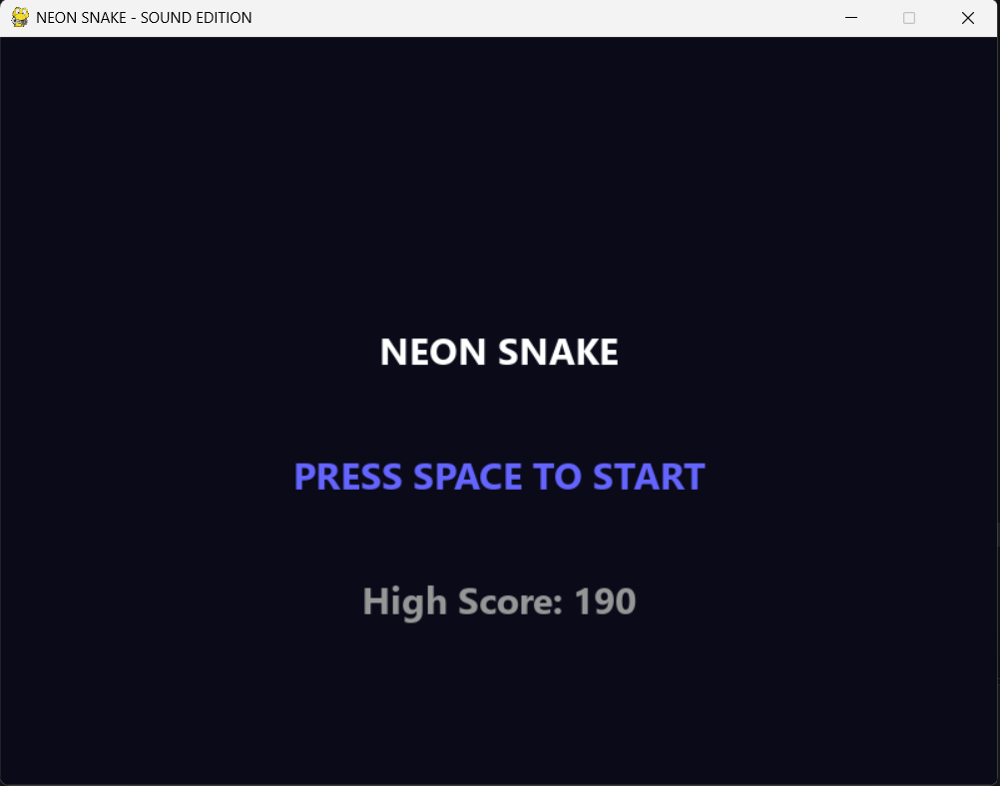
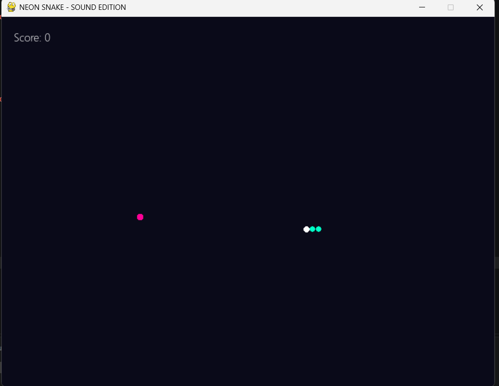
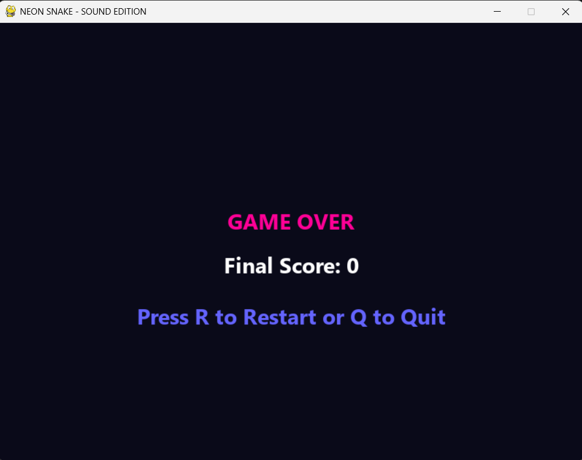

# NEON SNAKE — Sound Edition

A neon-themed Snake game built with **Python 3.11** and **Pygame**. Eat the pink food, avoid hitting the walls or your own body, and beat your high score.

## Game Screenshots

### Start Menu


### Gameplay


### Game Over


## Features

- Neon visuals with a dark background
- Keyboard-based movement
- Score increases by 10 for each food eaten
- High score stored locally in `highscore.json`
- WAV sound effects for eating, game over, and key presses
- Game speed increases as food is eaten

## Requirements

- **Python 3.11**
- Packages listed in `requirements.txt`
- Windows, macOS, or Linux with a working audio device for sound

## Project Structure

```text
snake_game/
├── snake_game_sound.py   # Main game file
├── snake.py              # Additional Python file
├── requirements.txt      # Python dependencies
├── eat.wav               # Food-eaten sound
├── die.wav               # Game-over sound
├── click.wav             # Key/menu sound
├── highscore.json        # High score data (created/updated by the game)
├── README.md             # Project documentation
└── images/
    ├── start-menu.png
    ├── gameplay.png
    ├── game-over.png
    └── project-structure.png
```

## Setup and Run

### 1. Install Python 3.11

Check your installed Python version:

```bash
python --version
```

It should show Python 3.11.x. If your system uses `python3`:

```bash
python3 --version
```

### 2. Open the project folder

Open a terminal in the `snake_game` project directory—the folder containing `snake_game_sound.py` and `requirements.txt`.

### 3. Create and activate a virtual environment (recommended)

**Windows PowerShell:**

```powershell
py -3.11 -m venv .venv
.\.venv\Scripts\Activate.ps1
```

**macOS / Linux:**

```bash
python3.11 -m venv .venv
source .venv/bin/activate
```

### 4. Install requirements first

Run this from the project directory after activating the virtual environment:

```bash
python -m pip install --upgrade pip
python -m pip install -r requirements.txt
```

### 5. Run the game

```bash
python snake_game_sound.py
```

Keep `eat.wav`, `die.wav`, and `click.wav` in the same working directory as the main Python file so the sound effects can be loaded.

## Controls

| Key | Action |
|---|---|
| `Space` | Start the game |
| `Up Arrow` | Move up |
| `Down Arrow` | Move down |
| `Left Arrow` | Move left |
| `Right Arrow` | Move right |
| `R` | Restart after game over |
| `Q` | Quit after game over |

## Score and Saved Data

- Eating food adds **10 points**.
- The game reads and updates `highscore.json` to keep the high score between runs.
- `highscore.json` must be writable by the current user.

## Troubleshooting

### `ModuleNotFoundError: No module named 'pygame'`

Make sure the virtual environment is activated, then install the requirements again:

```bash
python -m pip install -r requirements.txt
```

### Sound effects are missing

Check that all three WAV files are in the project directory and that your system audio is enabled.

### `python` runs a different version

Check the version with `python --version`. On Windows, you can explicitly create the environment with `py -3.11`; on macOS/Linux, use `python3.11`.

## License

This project is licensed under the MIT License. See the LICENSE file for details.
